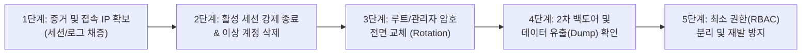

# 🔐 홈랩 인프라 & GitHub 계정 보안 감사 및 이상 계정 대응 가이드 (`account-security-guide.md`)

이 문서는 홈랩 인프라(MongoDB, PostgreSQL, RabbitMQ, OpenSearch, Authelia 등)와 GitHub 저장소에서 **승인되지 않은 이상 계정(유령 계정, 백도어 계정, 미삭제 데모 계정)**을 탐지하는 방법과, **이상 계정 발견 시 증거를 보존하며 안전하게 차단·복구하는 5단계 표준 침해 대응(Incident Response) 절차**를 안내합니다.

AI 에이전트 전용 런북: [`.agents/references/account-security.md`](file:///Users/limkeunhyeok/workspace/homelab-infra/.agents/references/account-security.md)

---

## 1. 원클릭 전체 인프라 계정 전수 감사 (`make audit-users`)

터미널에서 아래 명령어 한 줄을 실행하면 클러스터 내 주요 서비스에 등록된 모든 계정과 권한(Role) 목록을 즉시 출력합니다:

```bash
make audit-users
```

### 📋 홈랩 정상 계정 화이트리스트 (Baseline 기준표)

`make audit-users` 실행 결과가 아래 기준표와 다를 경우(내가 만들지 않은 계정이 존재하는 경우) 즉시 **2장의 대응 절차**를 수행하십시오.

| 서비스 | 정상 승인 계정 (Allowlist) | 보유 권한 | 비고 |
| :--- | :--- | :--- | :--- |
| **PostgreSQL** | `postgres` | `superuser`, `createdb` | 이외 계정 발견 시 점검 필수 |
| **MongoDB** | `admin` (DB: `admin`) | `root@admin` | `admin.system.users` 전체 기준 |
| **RabbitMQ** | `admin` | `[administrator]` | `guest` 등 추가 계정 없어야 정상 |
| **OpenSearch** | `admin` (및 기본 내장 계정 6종) | `admin` | 기본 내장(`logstash`, `kibanaserver`, `readall`, `kibanaro`, `snapshotrestore`, `anomalyadmin`) 외 미승인 계정 발견 시 점검 |
| **Authelia SSO** | `admin` (선택: `guest`) | `admins`, `dev` | `k8s/authelia/users_database.yml` 관리 |

---

## 2. 🚨 이상 계정 발견 시 5단계 표준 대응 절차 (Incident Response)

모르는 계정을 발견했을 때 **가장 흔히 하는 실수는 "당황해서 계정만 바로 지우고(`dropUser`) 끝내는 것"**입니다.
그 계정을 만든 **최초 침투 경로(유출된 루트 비밀번호 등)**를 그대로 두면 공격자는 5분 뒤에 또 다른 이름으로 계정을 만듭니다. 반드시 아래 **5단계 순서**대로 조치하십시오.



---

### [1단계] 계정 삭제 전: 현재 접속 세션(IP) 및 생성 시각 채증

계정을 지우기 전에 **그 계정이 지금 접속 중인지, 어느 IP에서 접속했는지, 언제 생성되었는지** 먼저 확인합니다.

#### 🍃 MongoDB
```bash
# 1) 현재 활성 커넥션 및 실행 중인 쿼리/클라이언트 IP 확인
kubectl exec -n infra mongodb-0 -c mongodb -- /bin/bash -c '
  mongosh -u "$MONGO_INITDB_ROOT_USERNAME" -p "$MONGO_INITDB_ROOT_PASSWORD" --authenticationDatabase admin --quiet --eval "
    db.currentOp(true).inprog.filter(op => op.client || op.effectiveUsers).map(op => ({
      opid: op.opid, client: op.client, appName: op.appName, users: op.effectiveUsers, command: op.command
    }))
  "
'

# 2) Loki(Grafana)에서 해당 이상 계정명 또는 createUser 로그 추적
# Grafana 대시보드(https://grafana.homelab.local/d/infra-anomaly-detection) 상단 Search 창에
# 이상 계정명 또는 "createUser" 입력
```

#### 🐘 PostgreSQL
```bash
# 현재 접속 중인 계정, 클라이언트 IP(client_addr), 실행 쿼리 확인
kubectl exec -n infra deploy/postgres -- psql -U postgres -c \
  "SELECT pid, usename, client_addr, application_name, state, backend_start, query FROM pg_stat_activity WHERE usename IS NOT NULL;"
```

#### 🐇 RabbitMQ
```bash
# 현재 연결된 AMQP 커넥션 및 접속자/IP 확인
kubectl exec -n infra rabbitmq-0 -- rabbitmqctl list_connections user peer_host peer_port state
```

---

### [2단계] 활성 세션 강제 종료(Kill) 및 이상 계정 즉시 삭제

공격자의 연결을 즉시 끊고 이상 계정을 삭제합니다 (`<ROGUE_USER>` 자리에 발견된 이상 계정명 입력).

#### 🍃 MongoDB 이상 계정 삭제
```bash
# 1) 해당 계정이 속한 DB(보통 admin)에서 계정 삭제
kubectl exec -n infra mongodb-0 -c mongodb -- /bin/bash -c '
  mongosh -u "$MONGO_INITDB_ROOT_USERNAME" -p "$MONGO_INITDB_ROOT_PASSWORD" --authenticationDatabase admin --eval "
    db.getSiblingDB(\"admin\").dropUser(\"<ROGUE_USER>\")
  "
'
```

#### 🐘 PostgreSQL 이상 계정 및 세션 삭제
```bash
# 1) 해당 계정의 모든 활성 연결 강제 종료
kubectl exec -n infra deploy/postgres -- psql -U postgres -c \
  "SELECT pg_terminate_backend(pid) FROM pg_stat_activity WHERE usename = '<ROGUE_USER>';"

# 2) 소유 객체 회수 및 계정 삭제
kubectl exec -n infra deploy/postgres -- psql -U postgres -c \
  "REASSIGN OWNED BY <ROGUE_USER> TO postgres; DROP OWNED BY <ROGUE_USER>; DROP ROLE <ROGUE_USER>;"
```

#### 🐇 RabbitMQ 이상 계정 삭제
```bash
kubectl exec -n infra rabbitmq-0 -- rabbitmqctl delete_user "<ROGUE_USER>"
```

#### 🔍 OpenSearch 미승인 이상 계정 삭제
OpenSearch 기본 내장 계정 외에 승인되지 않은 이상 계정(`<ROGUE_USER>`)이 발견된 경우 즉시 제거합니다:
```bash
kubectl exec -n infra opensearch-0 -- /bin/bash -c '
  curl -s -k -X DELETE -u "admin:$OPENSEARCH_INITIAL_ADMIN_PASSWORD" \
    "https://localhost:9200/_plugins/_security/api/internalusers/<ROGUE_USER>" && echo ""
'
```
*(주의: `admin` 및 기본 내장 시스템 계정은 삭제하지 마십시오)*

#### 🔐 Authelia SSO 계정 삭제
1. 로컬 `k8s/authelia/users_database.yml` 파일에서 해당 계정 블록을 삭제합니다.
2. 시크릿을 갱신합니다:
   ```bash
   make secrets
   ```

---

### [3단계] 침투 경로 차단: 전체 인프라 루트 비밀번호 일괄 교체 (필수)

누군가 DB에 새 계정을 만들었다는 것은 **기존 관리자(`admin`/`postgres`) 비밀번호가 이미 유출되었다는 뜻**입니다. 이상 계정만 지우면 다시 들어오므로, 즉시 전체 비밀번호를 교체합니다:

```bash
# 7대 인프라 서비스 비밀번호를 새로운 16자리 랜덤 암호로 일괄 교체
./scripts/rotate-password.sh all
```
* 애플리케이션(`my-space-api`, `my-space-ai`)이 사용하는 `k8s/apps/*/.env.*` 파일의 DB 비밀번호도 새 값(`.credentials.local` 참조)으로 맞춘 뒤 `make secrets` ➔ 파드 재기동을 수행합니다.

---

### [4단계] 데이터 유출(Dump) 및 2차 피해 여부 확인

1. **Grafana 이상 징후 대시보드 확인**:
   * https://grafana.homelab.local/d/infra-anomaly-detection 에 접속합니다.
   * **`2. 대량 데이터 반출(Dump) 및 리소스 스파이크 탐지`** 섹션의 **`DB/스토리지 외부 반출 트래픽 급증 탐지 (Outbound TX)`** 그래프에서 비정상적인 송신 트래픽 피크(수십 MB/s 이상)가 있었는지 확인합니다.
   * **`3. MongoDB 이상 징후 뷰`**에서 `COLLSCAN`(컬렉션 전체 스캔)이나 낯선 클라이언트 IP(`client=...`) 접속 기록을 확인합니다.
2. **재검증**:
   ```bash
   make audit-users
   ```
   명령을 다시 실행하여 승인된 계정만 남아있는지 최종 확인합니다.

---

### [5단계] 재발 방지: 루트 계정 봉인 및 최소 권한(RBAC) 분리

침해 복구가 끝난 후에는 애플리케이션이나 개발자가 루트 계정(`admin`, `postgres`)을 직접 쓰지 않도록 **3장의 신규 계정 생성 가이드**에 따라 최소 권한 계정으로 분리합니다.

---

## 3. 🛠️ 인프라별 신규 계정 안전 생성 및 권한 분리(RBAC) 가이드

새로운 마이크로서비스나 개발자/분석 도구를 연동할 때는 루트 계정을 공유하지 말고, 아래 절차에 따라 **계정 생성 권한(`createUser`/`CREATEROLE`)이 제거된 용도별 전용 계정**을 생성하십시오.

> [!TIP]
> **신규 계정용 16자리 안전한 랜덤 비밀번호 생성 명령어**:
> ```bash
> LC_ALL=C tr -dc 'A-Za-z0-9!@#%^*_+-=' < /dev/urandom | head -c 16; echo ""
> ```

---

### 3.1 🍃 MongoDB 권한별 계정 생성 및 관리

MongoDB에서는 모든 계정을 `admin` DB에서 통합 관리하되, **`roles` 배열에서 대상 데이터베이스(`db`)와 권한(`readWrite` 또는 `read`)을 제한**하는 것이 실무 표준입니다.

#### 1) 백엔드 애플리케이션 전용 계정 생성 (`readWrite` 권한만 부여)
* 특징: 지정된 DB(`myspace`)의 데이터 읽기/쓰기만 가능하며, **절대 다른 DB를 조회하거나 새 계정을 생성(`createUser`)할 수 없습니다.**
```bash
kubectl exec -n infra mongodb-0 -c mongodb -- /bin/bash -c '
  mongosh -u "$MONGO_INITDB_ROOT_USERNAME" -p "$MONGO_INITDB_ROOT_PASSWORD" --authenticationDatabase admin --eval "
    db.getSiblingDB(\"admin\").createUser({
      user: \"myspace_app\",
      pwd: \"<NEW_STRONG_PASSWORD>\",
      roles: [
        { role: \"readWrite\", db: \"myspace\" }
      ]
    })
  "
'
```
* **애플리케이션 접속 URI 예시**:
  ```text
  mongodb://myspace_app:<PASSWORD>@mongodb-0.mongo-headless.infra.svc.cluster.local:27017,mongodb-1.mongo-headless.infra.svc.cluster.local:27017,mongodb-2.mongo-headless.infra.svc.cluster.local:27017/myspace?replicaSet=rs0&authSource=admin
  ```

#### 2) 개발자 / 데이터 분석용 읽기 전용 계정 생성 (`read` 권한만 부여)
* 특징: 데이터 조회(`find`, `aggregate`)만 가능하며, 데이터 수정/삭제(`insert`, `update`, `delete`, `drop`)가 원천 차단됩니다.
```bash
kubectl exec -n infra mongodb-0 -c mongodb -- /bin/bash -c '
  mongosh -u "$MONGO_INITDB_ROOT_USERNAME" -p "$MONGO_INITDB_ROOT_PASSWORD" --authenticationDatabase admin --eval "
    db.getSiblingDB(\"admin\").createUser({
      user: \"myspace_readonly\",
      pwd: \"<NEW_STRONG_PASSWORD>\",
      roles: [
        { role: \"read\", db: \"myspace\" }
      ]
    })
  "
'
```

#### 3) 기존 계정의 권한 추가 / 회수 / 비밀번호 변경
```bash
# 권한 추가 (grantRolesToUser)
kubectl exec -n infra mongodb-0 -c mongodb -- /bin/bash -c '
  mongosh -u "$MONGO_INITDB_ROOT_USERNAME" -p "$MONGO_INITDB_ROOT_PASSWORD" --authenticationDatabase admin --eval "
    db.getSiblingDB(\"admin\").grantRolesToUser(\"myspace_app\", [{ role: \"read\", db: \"analytics\" }])
  "
'

# 권한 회수 (revokeRolesFromUser)
kubectl exec -n infra mongodb-0 -c mongodb -- /bin/bash -c '
  mongosh -u "$MONGO_INITDB_ROOT_USERNAME" -p "$MONGO_INITDB_ROOT_PASSWORD" --authenticationDatabase admin --eval "
    db.getSiblingDB(\"admin\").revokeRolesFromUser(\"myspace_app\", [{ role: \"read\", db: \"analytics\" }])
  "
'
```

---

### 3.2 🐘 PostgreSQL 권한별 계정 생성 및 관리

PostgreSQL에서는 반드시 **`NOSUPERUSER NOCREATEDB NOCREATEROLE`** 옵션을 명시하여, 해당 계정이 탈취되더라도 슈퍼유저 권한 행사나 유령 계정 추가를 할 수 없도록 막아야 합니다.

#### 1) 백엔드 애플리케이션 전용 계정 생성 (`readWrite` + 마이그레이션 권한)
```bash
kubectl exec -n infra deploy/postgres -- psql -U postgres -d homelab_db -c "
  -- 1. 슈퍼유저 및 계정 생성 권한이 없는 일반 로그인 역할 생성
  CREATE ROLE myspace_app WITH LOGIN PASSWORD '<NEW_STRONG_PASSWORD>' NOSUPERUSER NOCREATEDB NOCREATEROLE;

  -- 2. 데이터베이스 접속 및 public 스키마 사용/생성 권한 부여
  GRANT CONNECT ON DATABASE homelab_db TO myspace_app;
  GRANT USAGE, CREATE ON SCHEMA public TO myspace_app;

  -- 3. 기존 모든 테이블/시퀀스에 대한 읽기·쓰기 권한 부여
  GRANT SELECT, INSERT, UPDATE, DELETE ON ALL TABLES IN SCHEMA public TO myspace_app;
  GRANT USAGE, SELECT ON ALL SEQUENCES IN SCHEMA public TO myspace_app;

  -- 4. 향후 생성될 테이블에도 자동으로 권한 부여
  ALTER DEFAULT PRIVILEGES IN SCHEMA public GRANT SELECT, INSERT, UPDATE, DELETE ON TABLES TO myspace_app;
  ALTER DEFAULT PRIVILEGES IN SCHEMA public GRANT USAGE, SELECT ON SEQUENCES TO myspace_app;
"
```

#### 2) 개발자 / 분석용 읽기 전용(`Read-Only`) 계정 생성
PostgreSQL 14 이상에서 기본 제공하는 `pg_read_all_data` 내장 역할을 활용하면 단 두 줄로 안전한 읽기 전용 계정을 만들 수 있습니다:
```bash
kubectl exec -n infra deploy/postgres -- psql -U postgres -d homelab_db -c "
  CREATE ROLE myspace_readonly WITH LOGIN PASSWORD '<NEW_STRONG_PASSWORD>' NOSUPERUSER NOCREATEDB NOCREATEROLE;
  GRANT CONNECT ON DATABASE homelab_db TO myspace_readonly;
  GRANT pg_read_all_data TO myspace_readonly;
"
```

---

### 3.3 🐇 RabbitMQ 권한별 계정 및 vhost 생성

RabbitMQ에서는 애플리케이션 워커 계정에 `administrator` 태그를 부여하지 않고, 특정 가상 호스트(`vhost`)에 대한 큐/익스체인지 권한만 부여합니다.

#### 1) 애플리케이션 전용 계정 생성 (관리자 태그 제외)
```bash
# 1. 신규 계정 생성
kubectl exec -n infra rabbitmq-0 -- rabbitmqctl add_user myspace_app "<NEW_STRONG_PASSWORD>"

# 2. 기본 vhost("/")에 대해 설정(configure), 쓰기(write), 읽기(read) 권한만 부여 (관리자 태그 없음)
kubectl exec -n infra rabbitmq-0 -- rabbitmqctl set_permissions -p "/" myspace_app ".*" ".*" ".*"
```

#### 2) 대시보드 모니터링 전용 계정 생성 (`monitoring` 태그)
```bash
kubectl exec -n infra rabbitmq-0 -- rabbitmqctl add_user myspace_monitor "<NEW_STRONG_PASSWORD>"
kubectl exec -n infra rabbitmq-0 -- rabbitmqctl set_user_tags myspace_monitor monitoring
kubectl exec -n infra rabbitmq-0 -- rabbitmqctl set_permissions -p "/" myspace_monitor "^$" "^$" ".*"
```

---

### 3.4 🔍 OpenSearch 내부 계정 생성

OpenSearch Security 플러그인의 REST API를 사용하여 특정 역할(`backend_roles`)만 가진 계정을 생성합니다:

```bash
# 읽기 전용(readall) 권한을 가진 분석가 계정 생성 예시
kubectl exec -n infra opensearch-0 -- /bin/bash -c '
  curl -s -k -X PUT -u "admin:$OPENSEARCH_INITIAL_ADMIN_PASSWORD" \
    "https://localhost:9200/_plugins/_security/api/internalusers/myspace_reader" \
    -H "Content-Type: application/json" \
    -d "{
      \"password\": \"<NEW_STRONG_PASSWORD>\",
      \"backend_roles\": [\"readall\"]
    }" && echo ""
'
```

---

### 3.5 🔐 Authelia SSO 게이트웨이 사용자 추가

1. **Argon2id 비밀번호 해시 생성**:
   ```bash
   kubectl exec -n infra deploy/authelia -- authelia crypto hash generate argon2 --password '<NEW_STRONG_PASSWORD>'
   ```
2. **로컬 `k8s/authelia/users_database.yml`에 계정 추가**:
   ```yaml
   users:
     new_user:
       displayname: "New Developer"
       password: "$argon2id$v=19$m=65536,t=3,p=4$..."
       email: "dev@homelab.local"
       groups:
         - "dev"
   ```
3. **클러스터 Secret 반영**:
   ```bash
   make secrets
   ```

---

### 3.6 ✅ 신규 계정 생성 후 필수 사후 체크리스트 (유령 계정 오인 방지)

계정을 새로 만든 뒤 기록을 남기지 않으면, 나중에 본인이나 에이전트가 `make audit-users`를 돌렸을 때 **침해 사고로 생긴 유령 계정인지 정상 계정인지 구분할 수 없게 됩니다.** 계정 생성 직후 반드시 아래 3가지를 수행하십시오:

1. **`.credentials.local` 파일에 기록**:
   * 프로젝트 루트의 `.credentials.local`(Git 제외 파일)에 새로 만든 계정명, 비밀번호, 용도를 주석과 함께 기록합니다.
2. **본 문서 1장의 `정상 계정 화이트리스트(Baseline 기준표)` 업데이트**:
   * 본 문서 상단 표의 `정상 승인 계정 (Allowlist)` 칸에 신규 계정명을 추가합니다.
3. **`make audit-users` 실행 및 검증**:
   ```bash
   make audit-users
   ```
   명령을 실행하여 의도한 권한(Role)으로 정확히 생성되었는지 최종 확인합니다.

---

## 4. 🐙 GitHub 계정 및 리포지토리 백도어 점검/조치 가이드

GitHub에서도 계정 토큰(PAT)이나 세션이 유출되면 공격자가 **몰래 외부 협력자(Collaborator)를 추가하거나, Deploy Key(SSH 키) 및 Webhook을 심어두는 방식**으로 백도어를 만듭니다.

### 4.1 GitHub 백도어 4대 점검 명령어 (`gh` CLI 활용)

맥북 터미널에서 아래 명령어로 내 계정과 리포지토리에 모르는 사람이나 키가 등록되어 있지 않은지 즉시 확인할 수 있습니다:

```bash
# 1. 현재 리포지토리에 접근 권한이 있는 모든 계정(Collaborators) 확인
gh api repos/lkh-space/homelab-infra/collaborators --jq '.[] | {login: .login, role: .role_name}'

# 2. 리포지토리에 등록된 Deploy Key(SSH 키) 확인 (내가 등록한 적 없는 키가 있으면 백도어!)
gh api repos/lkh-space/homelab-infra/keys

# 3. 리포지토리에 등록된 외부 웹훅(Webhooks) 확인
gh api repos/lkh-space/homelab-infra/hooks

# 4. 내 개인 GitHub 계정에 등록된 전체 SSH 공개키 확인
gh api user/keys
```

### 4.2 GitHub에서 이상 징후 발견 시 즉시 조치 절차

1. **수상한 SSH Key / Deploy Key / PAT 즉시 삭제 (Revoke)**:
   * 개인 설정: GitHub 우측 상단 프로필 ➔ `Settings` ➔ **`SSH and GPG keys`** 및 **`Developer settings` ➔ `Personal access tokens`**에서 모르는 키/토큰 즉시 `Delete` / `Revoke`.
   * 리포지토리 설정: 리포지토리 `Settings` ➔ **`Deploy keys`** 및 **`Collaborators`**에서 미승인 항목 즉시 제거.
2. **활성 웹 세션 강제 로그아웃**:
   * GitHub `Settings` ➔ **`Sessions`**에서 현재 내가 사용 중인 기기 외 모든 `Web sessions`를 `Revoke session` 처리.
3. **보안 감사 로그(Security Log)로 유출 범위 확인**:
   * 개인 계정: GitHub `Settings` ➔ **`Security log`**에서 최근 발생한 `repo.create`, `public_key.create`, `oauth_access` 이벤트와 접속 IP 확인.
   * Organization: `Organization Settings` ➔ **`Audit log`**에서 `action:org.add_member`, `action:repo.add_member`, `action:public_key.create` 검색.
4. **리포지토리 내 시크릿(GitHub Actions Secrets) 전면 교체**:
   * 계정이나 리포지토리 권한이 침해되었다면 리포지토리 `Settings` ➔ `Secrets and variables` ➔ `Actions`에 등록된 배포 키(Docker Hub 토큰, 클라우드 키 등)도 공격자가 워크플로우를 통해 탈취했을 가능성이 있으므로 모두 재발급하여 교체합니다.

