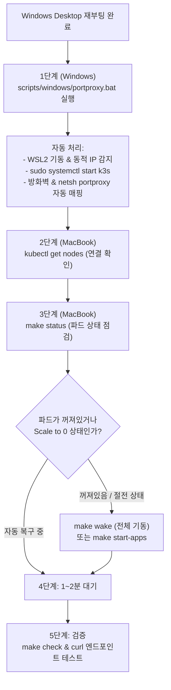

# Windows 호스트 재부팅 후 클러스터 & 서비스 복구 가이드 (Host Reboot Recovery Guide)

이 문서는 Windows Desktop 호스트가 재부팅(업데이트, 전원 차단, 사용자 재부팅 등)되었을 때, WSL2 기반 Kubernetes(k3s) 클러스터를 정상화하고 인프라 및 애플리케이션 서비스들을 완벽하게 다시 기동하는 표준 운영 절차(A to Z)를 정의합니다.

AI 에이전트 전용 런북: [`.agents/references/host-reboot-recovery.md`](file:///Users/limkeunhyeok/workspace/homelab-infra/.agents/references/host-reboot-recovery.md)

---

## 1. 전체 복구 프로세스 한눈에 보기



---

## 2. 단계별 복구 절차 (Step-by-Step)

### [1단계] Windows Desktop 호스트 작업 (원클릭 자동 복구)

Windows Desktop에 로그인한 뒤, 관리자 권한으로 아래 배치파일을 실행합니다:

- **실행 파일**: 저장소 루트의 `scripts/windows/portproxy.bat` (우클릭 ➔ 관리자 권한으로 실행 또는 더블클릭)
- **스크립트가 자동으로 처리하는 작업**:
  1. WSL2 Ubuntu를 백그라운드에서 깨우고 실시간 가상 IP(`hostname -I`) 자동 추출.
  2. WSL2 내부의 Kubernetes 데몬 자동 기동: `wsl -u root systemctl start k3s`.
  3. Windows 방화벽 인바운드 포트 허용 규칙 갱신.
  4. 외부 및 맥북 접속용 포트포워딩 자동 재등록:
     - `6443` (Kubernetes API Server)
     - `22` (SSH 터널링 및 Ansible)
     - `80`, `443` (Traefik Ingress HTTP/HTTPS)
     - `30900`, `30901` (MinIO S3 / Console NodePort)

> [!NOTE]
> **외부 네트워크(카페, 사무실 등)에서 원격 접속 시**:
> 윈도우 데스크탑과 맥북 모두 **Tailscale** 앱이 로그인되어 켜져 있는지 확인하십시오.

---

### [2단계] MacBook 제어 환경에서 클러스터 연결 확인

MacBook 터미널(`homelab-infra` 디렉토리)에서 노드 통신을 확인합니다:

```bash
kubectl get nodes -o wide
```

- **정상 출력 예시**:
  ```text
  NAME          STATUS   ROLES                  AGE   VERSION        INTERNAL-IP
  lkh-desktop   Ready    control-plane,master   35d   v1.30.2+k3s1   172.x.x.x
  ```
- **만약 연결 실패 시 (`i/o timeout` 또는 `connection refused`)**:
  - 호스트 핑 확인: `ping -c 3 192.168.0.10`
  - 1단계의 `portproxy.bat`이 정상 완료되었는지 다시 확인.

---

### [3단계] 워크로드(서비스) 상태 점검 및 재기동

k3s 데몬이 정상 기동되면, Kubernetes Kubelet이 이전에 실행 중이던 컨테이너들을 1~2분 내에 자동으로 다시 스케줄링하여 기동합니다.

#### 1) 파드 상태 조회
```bash
make status
```

#### 2) 서비스 재기동 (필요 시)
만약 이전에 `make sleep`이나 `make stop`으로 절전(Scale to 0) 모드였거나, 일부 서비스가 내려가 있는 경우 아래 명령어로 원하는 수준으로 기동합니다:

- **옵션 A: 전체 인프라 및 애플리케이션 일괄 기동 (권장)**:
  ```bash
  make wake
  ```
  *(내부 동작: 의존성 순서에 따라 Postgres/Redis/RabbitMQ/MinIO/Authelia ➔ 모니터링 스택 ➔ OpenSearch & Mongo 3노드 ➔ My Space 앱 순차 기동)*

- **옵션 B: 핵심 데이터 인프라만 기동**:
  ```bash
  make start
  ```

- **옵션 C: My Space 애플리케이션만 기동 (자원 절약 모드 유지)**:
  ```bash
  make start-apps
  ```

---

### [4단계] 핵심 데이터베이스 정족수(Quorum) 점검

MongoDB는 3개 노드 ReplicaSet(`rs0`)으로 동작하므로, 반드시 3개 노드가 모두 기동되어 Quorum을 형성해야 합니다:

```bash
# MongoDB 3개 파드 기동 확인 (mongodb-0, mongodb-1, mongodb-2)
kubectl get statefulset -n infra mongodb

# 상태가 3/3이 아니면 3노드 강제 스케일
make start-mongo
```

---

### [5단계] 헬스체크 및 엔드포인트 최종 검증

모든 서비스가 정상적으로 네트워크 트래픽을 수신할 수 있는지 일괄 검증합니다:

```bash
# 1. 7대 핵심 인프라 서비스 헬스체크
make check

# 2. 모니터링 스택 헬스체크
make check-monitoring

# 3. 외부 공개 Ingress 및 웹/API 응답 확인
curl -k -I https://api.homelab.local/health
# ➔ HTTP/2 200 OK

curl -k -I https://my-space.homelab.local
# ➔ HTTP/2 302 Found (Authelia SSO 리다이렉트)
```

---

## 3. 자주 묻는 질문 및 트러블슈팅

### Q1. `kubectl get nodes` 실행 시 `certificate has expired or is not yet valid` 에러가 납니다.
- **원인**: 데스크탑이 꺼져있는 동안 시스템 시간이 어긋났거나 인증서 갱신 불일치.
- **조치**: MacBook에서 `ansible-playbook playbooks/install-k3s.yml`을 실행하여 kubeconfig를 재동기화합니다.

### Q2. 인그레스 도메인(`*.homelab.local`)이 접속되지 않습니다.
- **원인**: 맥북의 `/etc/hosts` 설정이 누락되었거나 호스트 IP가 변경됨.
- **조치**: MacBook에서 `make hosts` 실행 (`sudo ./scripts/setup-hosts.sh 192.168.0.10`).
